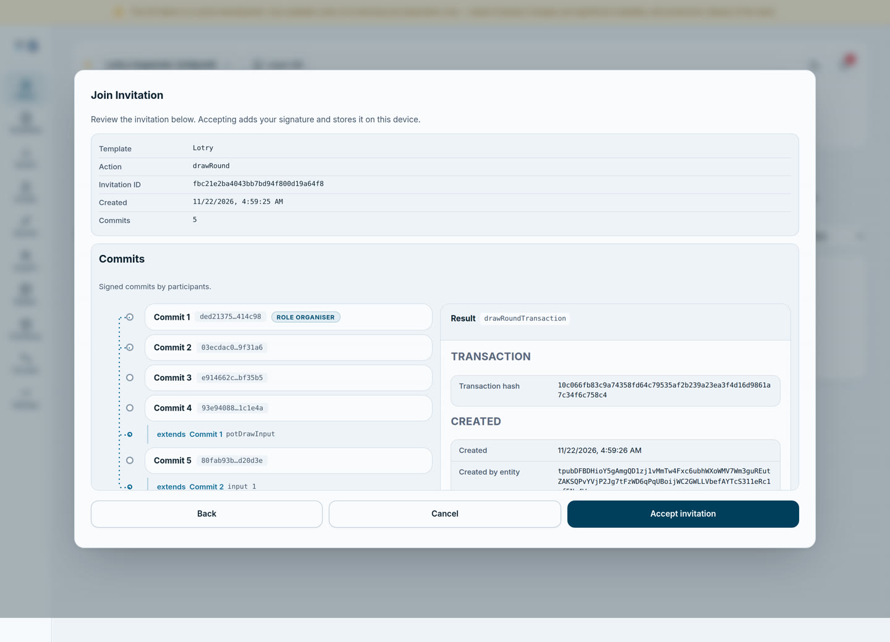

# Lotry on XO

> **BCH BLAZE 2026** · deadline **22 Nov 2026, 09:00 UTC-5 (14:00 UTC)** · bounties: **Migrate to XO**, **Build with XO**

**The lottery the organiser can't run away with.**
[Lotry.fun](https://www.lotry.fun), our on-chain lottery (built on Base for Base Batch India 2025, where it was runner-up;
now running on Solana), migrated to Bitcoin Cash as one [XO](https://stack.xo.cash) template:
[`src/lotry-template.mjs`](src/lotry-template.mjs) (as XO JSON: [`templates/lotry.json`](templates/lotry.json)).

**Play it in your browser:** [lotry-xo.exprmnts.fun/play.html](https://lotry-xo.exprmnts.fun/play.html). Every button builds a real
transaction against the real covenant and runs it in the BCH 2026 VM, including eight ways to try to cheat it.

- One round lives in one coin, **the pot**, locked to a covenant with **no keys at all**. It only ever pays the winning ticket or refunds tickets.
- **Tickets are numbered NFTs** (CashTokens) that the players hold in their own wallets.
- **The chain picks the winner.** The organiser commits to a secret when opening the round. After the draw height anyone closes ticket sales, then the organiser reveals the secret and the covenant itself computes `sha256(secret) mod tickets + 1`.
- **Nothing gets stuck:** if the round is never drawn, every ticket refunds after the refund height; if the winner never claims, every ticket refunds after the claim deadline.
- Everything runs through **XO invitations**: a ticket sale is a two-party invitation (the organiser adds the pot, the player adds coins and receives the ticket), and close, draw, claim and refund are **follow-up actions** of the pot and of the ticket.

## Live on Chipnet

Two rounds on the current template, every step a **confirmed** Chipnet transaction made from an XO invitation. The full
list, with every invitation file, is in [`docs/PROOF.md`](docs/PROOF.md). Round A is the whole story:

| Step | What happened | Transaction |
|---|---|---|
| Open | Token genesis: the pot gets the round's minting NFT, commitment = 0 tickets | [46c83ca8…](https://chipnet.imaginary.cash/tx/46c83ca89a6bd1e57c1b3f5061f8ee5e3297719db70d6f2319dd74a7515b6ef9) |
| Ticket #1 | Two-party invitation: organiser adds the pot, buyer A pays and receives ticket #1 (after checking the round's genesis) | [5f4e4f2c…](https://chipnet.imaginary.cash/tx/5f4e4f2ce1ccd617f8f075c53ed233e31e0c105f193ed09e51150c162cdcd370) |
| Ticket #2 | Two-party invitation: organiser adds the pot, buyer B pays and receives ticket #2 (after checking the round's genesis) | [4d5822f2…](https://chipnet.imaginary.cash/tx/4d5822f2e6607af47ccb4b4ec197c97828ac5e83a50696b2f43925a2104ce6ad) |
| Ticket #3 | Two-party invitation: organiser adds the pot, buyer A pays and receives ticket #3 (after checking the round's genesis) | [88688e5a…](https://chipnet.imaginary.cash/tx/88688e5ac105111dd48bff1cebb3c24fdc03aaa4a5d57149054b0464a74d09e9) |
| Close | After the draw height anyone closes sales: count frozen at 3 (`…c1`) | [127f6185…](https://chipnet.imaginary.cash/tx/127f61857df71b68bf620a865f87b054cd545f56ce9e2e995cb7b8a3715c882f) |
| Draw | Secret revealed on the closed pot; the covenant writes "ticket #3 won" into it | [10c066fb…](https://chipnet.imaginary.cash/tx/10c066fb83c9a74358fd64c79535af2b239a23ea3f4d16d9861a7c34f6c758c4) |
| Claim | Buyer A spends the pot with ticket #3; both NFTs burned, the pot paid out | [7b0c247e…](https://chipnet.imaginary.cash/tx/7b0c247e842d160646c7aeb4a57db881256efe3c7684a33fa63235a8f07238dc) |

Round B shows the safety net: drawn ([902e28f8…](https://chipnet.imaginary.cash/tx/902e28f8115f782c0c2332cf285ce66915f6cf4af11f186b71c431356d06cb85)), nobody claimed by the claim deadline, so the ticket
holder refunded ([5f3485a3…](https://chipnet.imaginary.cash/tx/5f3485a37c2fc05f541d2483de2c7f74dd49585d04be5771168a6724b520bee5)). Earlier rounds on the first version of the template are kept under
[`rounds-v1/`](rounds-v1) as history; they were funded from a faucet whose payouts paid too little fee and never confirmed,
which is why these rounds were re-run from the on-chain faucet contracts ([`scripts/faucet-contract.mjs`](scripts/faucet-contract.mjs)).

### In the XO debug tool

The template imports into [blaze.xo.cash](https://blaze.xo.cash) with the same identifier the invitations carry
(screenshots below are from the v1 rounds; the current template imports the same way). Each committed invitation opens with its signed commits and its broadcast
result, and the draw transaction verifies and can be stepped opcode by opcode:

| Ticket sale (buyTicket, organiser + player) | Draw (drawRound) | Draw transaction, stepped |
|---|---|---|
|  |  |  |

## How a round works

```
              organiser                   anyone, with the organiser            the winner / any ticket holder
  open ─────► POT  commitment 00000000 ──► buy ──► POT 01000000 + ticket #1 ──► ... ──► POT 03000000
  (genesis)   minting NFT, seed sats       (two-party invitation)                           │
                                                                                            ├─► draw (after drawHeight, reveals secret)
                                                                                            │     POT 01000000d0  = "ticket #1 won"
                                                                                            │       └─► claim: pot + winning ticket, both burned, all sats paid
                                                                                            └─► refund (after refundHeight, never drawn)
                                                                                                  one ticket burned, its price paid back
```

The pot's NFT commitment is the round's state: a 4-byte ticket count while open, then a marker byte for each later
phase: `0xc1` closed, `0xd0` drawn (the 4 bytes become the winning number), `0xee` refunding. The covenant (`potRedeem`)
has five paths, picked by the unlocking script:

| Path | Who | The covenant enforces |
|---|---|---|
| 1 buy | anyone, while open | the pot carries on (same script, same minting NFT), grows by exactly the ticket price, its count goes up by one, output 1 is an **immutable** ticket NFT numbered with the new count, and no other output carries a token (no extra tickets) |
| 5 close | anyone, after the draw height | `OP_CHECKLOCKTIMEVERIFY` past the draw height; the count is frozen (`…c1`), value and NFT unchanged. Sales stop **before** any reveal |
| 2 draw | whoever knows the secret | the pot is closed, `sha256(secret)` equals the committed hash, at least one ticket sold, the new commitment is exactly `sha256(secret) mod tickets + 1`, the pot keeps every satoshi |
| 3 claim | the winner | the pot is drawn, input 1 is a ticket of this round whose number is the winning number, and no output carries a token: the pot NFT and the ticket are burned and the satoshis go wherever the winner says |
| 4 refund | any ticket holder | past the refund height if never drawn (open or closed), or past the **claim deadline** if drawn and unclaimed; input 1 is a real ticket (immutable NFT, 4-byte number, no fungible amount); the pot carries on with exactly one ticket price less, marked refunding for good, and the ticket is burned |

There is no signature path in the covenant. 57 tests ([`test/covenant.test.mjs`](test/covenant.test.mjs)) run every path
and 41 attacks in libauth's BCH 2026 VM, and check that every rejection comes from the covenant itself; 3 more
([`test/sandbox.test.mjs`](test/sandbox.test.mjs)) play whole rounds and ten cheats through the browser sandbox's engine.

### Reviewed, then hardened
An independent adversarial review of the first version found four issues; all are fixed and tested:
1. **Refund then draw could lock the pot**: if a refunded ticket was then drawn, nobody could claim. The first refund now ends the round.
2. **A leaked secret could steer the draw**: the reveal sits in the mempool, and a failed draw left sales open. Sales now close (count frozen) before the reveal, and the CLI only reveals once the close is mined.
3. **Fake tickets**: fungible tokens of the round's category could pass as tickets in refunds. Tickets must now be immutable NFTs with a 4-byte number and no amount, and buyers check the round's genesis (one minting NFT at zero tickets, locked to the covenant) before paying ([`scripts/lib-genesis.mjs`](scripts/lib-genesis.mjs)).
4. **A lost winning ticket locked the pot forever**: a claim deadline now turns an unclaimed pot into refunds.

## The XO template

| | |
|---|---|
| Roles | `organiser` (opens, runs the pot, draws) and `player` (buys, claims, refunds) |
| Start | `openRound`, the only entry point |
| Actions | `openRound`, `buyTicket` (two participants: organiser + player), `closeRound`, `drawRound`, `claimPot`, `refundTicket` |
| Locking scripts | `potLockingScript` (P2SH32 covenant, state = the public round variables), `ticketLockingScript` (P2PKH of a key the player's wallet generates for each ticket) |
| Follow-ups | the pot offers `buyTicket`, `closeRound` and `drawRound` to the organiser; **the ticket itself offers `claimPot` and `refundTicket` to its player** |
| Formulas | `openCommitment`, `nextOpenCommitment`, `closedCommitment`, `drawnCommitment`, `refundingCommitment` and `winningTicketNumber` are template scripts; clients compile them to fill the commitment variables ([`src/round-state.mjs`](src/round-state.mjs)), and the tests prove they match what the covenant enforces |

A ticket sale as an invitation: the organiser creates `buyTicket`, adds the pot input and the new pot output and shares
it (`buy-N-1-offer.json`); the player accepts with the `player` role, which generates a fresh `playerKey`, adds the
ticket output locked to it, a funding input and change, and signs (`buy-N-2-buyer_x.json`); the organiser merges the
commits, adds the pot's unlocking script and broadcasts (`buy-N-3-sealed.json`). All of these files are committed under
[`rounds/`](rounds).

## Migrated from Lotry.fun

| Lotry.fun on Base (2025) | Lotry on XO (BCH BLAZE 2026) |
|---|---|
| Ticket tokens from `LotryTicket.sol` | Immutable CashTokens NFTs, numbered by the pot's minting NFT |
| A contract with an owner holds the pot | A covenant with no keys holds the pot; its NFT commitment is the round state |
| Randomness from Chainlink VRF (`RandomWalletPicker.sol`) | Commit-reveal: the secret's hash is fixed when the round opens, the covenant checks the reveal and computes the winner |
| The contract pays the winner | The winner claims by burning the winning ticket with the pot |
| (no refund if the draw never happens) | Every ticket refundable after the refund height if the round is never drawn |

Before BLAZE: [lotry.fun](https://www.lotry.fun) (live demo) and the contracts at
[exprmnts/Lotry_contract](https://github.com/exprmnts/Lotry_contract). Everything in this repository was written during
BLAZE (first commit 21 Nov 2026); the Lotry.fun code was used only as the specification of what a round does.

## Try it

Node 24. Chipnet coins come free from the proof-of-work faucet at chipnet.bch.ninja.

```bash
npm install
npm test                                        # 38 covenant tests in the BCH 2026 VM

node scripts/make-wallets.mjs                   # three demo wallets, mnemonics in ~/.config/pi/lotry-xo.env (outside the repo)
node scripts/addresses.mjs ORGANISER            # then BUYER_A, BUYER_B
node scripts/faucet.mjs <address> 300000        # fund each one

node scripts/lotry.mjs open --price 20000 --draw-in 1 --refund-in 144
node scripts/lotry.mjs offer                    # organiser: starts a ticket sale invitation
node scripts/lotry.mjs take BUYER_A             # player: joins, adds the ticket, pays, signs
node scripts/lotry.mjs seal                     # organiser: adds the pot's unlocking script, broadcasts
node scripts/lotry.mjs draw                     # after the draw lock height (about 10 minutes)
node scripts/lotry.mjs claim BUYER_A            # whoever holds the winning ticket
node scripts/lotry.mjs refund BUYER_B <round>   # undrawn rounds, after the refund lock height
node scripts/export-proof.mjs                   # rebuilds docs/PROOF.md
```

To inspect without running anything: open [blaze.xo.cash](https://blaze.xo.cash), create a throwaway chipnet account,
**Import Template** → paste [`templates/lotry.json`](templates/lotry.json), then **Join Invitation** → paste any file from
[`rounds/round-20261121T1949/invitations/`](rounds/round-20261121T1949/invitations) and **View invitation**, or
**Inspect** → paste a transaction id from the table above.

## Found while building

- **Chipnet now has 1-minute blocks, and lock times count 10-minute chunks.** CHIP-2025-03 (Faster Blocks) activated on
  chipnet on 15 Nov 2026. A block-height `nLockTime` / `OP_CHECKLOCKTIMEVERIFY` value now means a 600-tick chunk, so it
  advances once every ten blocks. We measured the activation height (332,451) by finding which lock times the network
  accepts, and the round's draw and refund heights are set in those units ([`src/chain-time.mjs`](src/chain-time.mjs)).
  Round 1 was opened before we knew, with a block height as its draw height, so its draw is about 57 days away; it stays
  as proof of the open and ticket steps.
- **Engine notes** (XO engine `0.1.1-next.18230317763`): the `@xo-cash/state` SQLite backend is a stub in 0.0.5, so Node
  runs on IndexedDB (fake-indexeddb, snapshotted to disk); token commitment expressions evaluate to hex text, so computed
  commitments travel as `token_commitment` variables; fee estimates do not count a P2SH32 input's redeem script, so
  pot-spending steps pay an explicit fee; one account per process; a buyer's wallet starts tracking the pot once it
  updates with the final, broadcast copy of its sale invitation.

## Stated plainly

- **The organiser knows the secret.** An organiser who also buys tickets before sales close could steer which ticket
  wins, like any raffle host who also plays. The covenant guarantees the pot can only pay a winning ticket or refunds;
  it can't stop the organiser from playing. Removing that trust needs every buyer to add randomness (commit-reveal by
  all players), our next step.
- **Chipnet only**, test coins. Ticket buying works from the CLI with any XO wallet; there is no browser wallet flow yet.
- A buyer should check the round's genesis transaction (one minting NFT, commitment 0) before buying; the CLI's rounds
  are all opened that way.
- Built with AI assistance: see [`AI_USAGE.md`](AI_USAGE.md).

## Team

Nikhil PN (builds it) and Hina Hanan (ideas and product direction). MIT licence.
