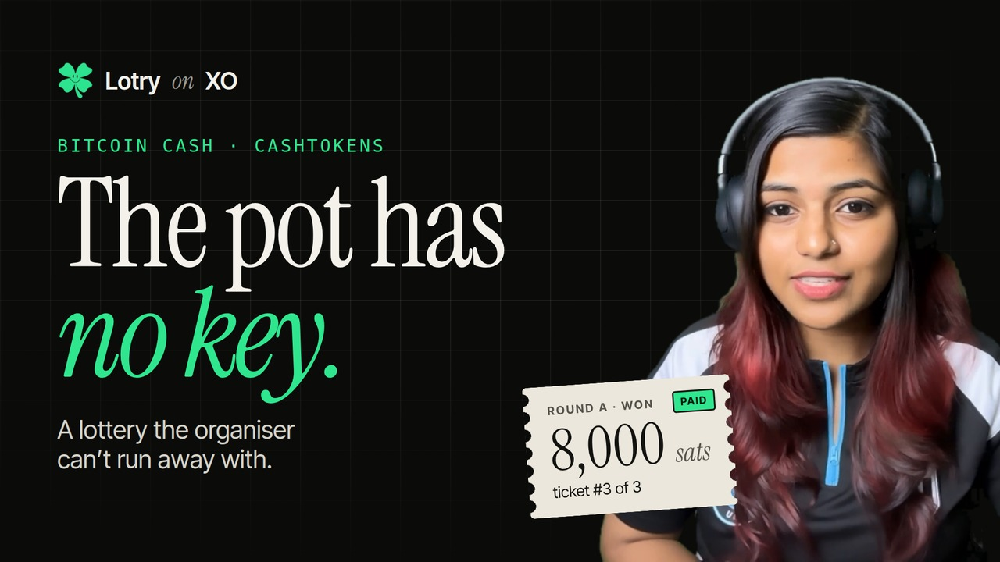
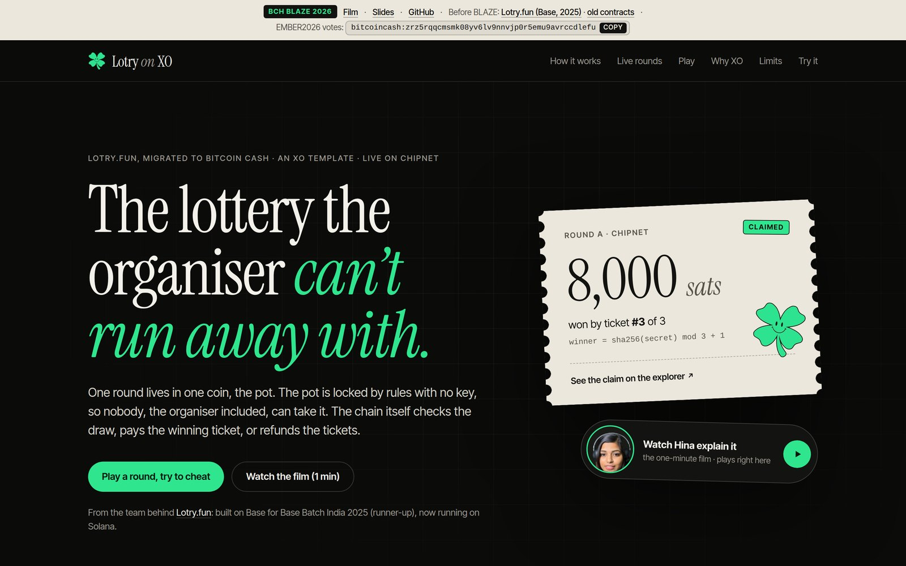
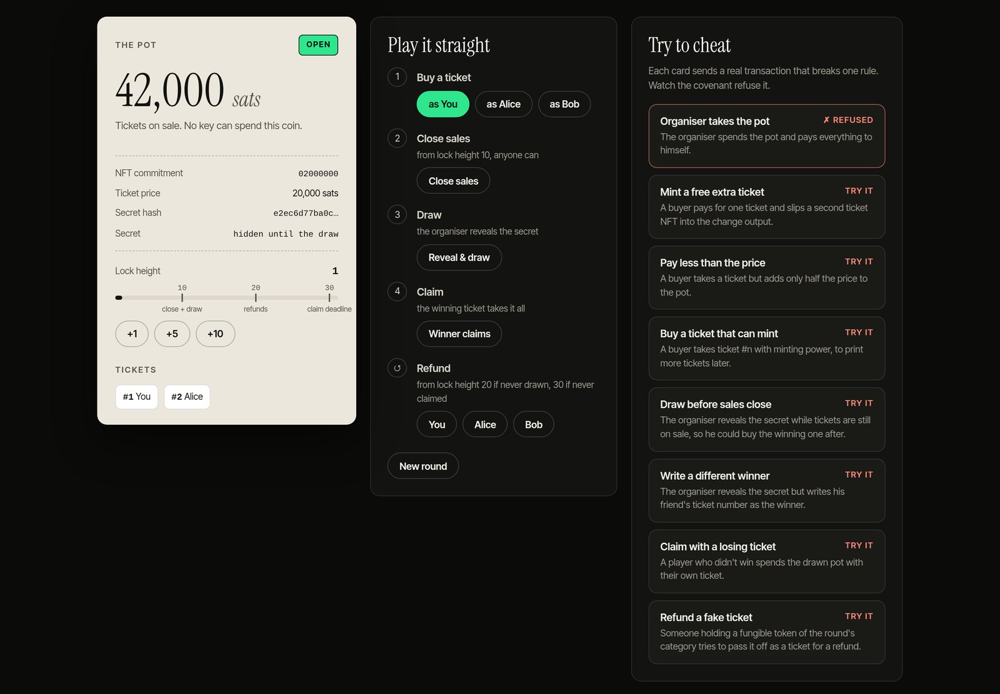
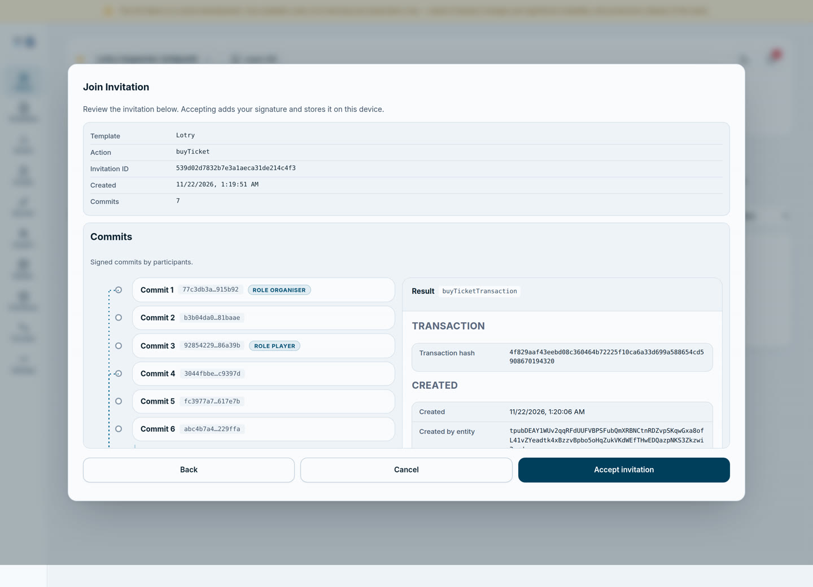
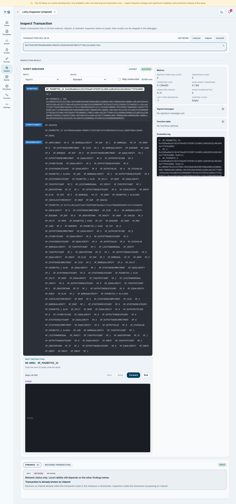
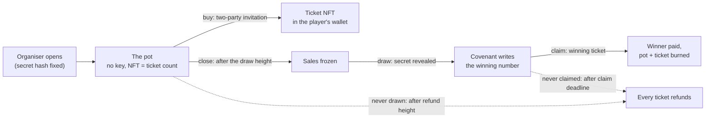

<div align="center">


# Lotry on XO

**The lottery the organiser can't run away with.**

Our on-chain lottery [Lotry.fun](https://www.lotry.fun), migrated to Bitcoin Cash as one [XO](https://stack.xo.cash) template.<br />
The pot is a coin with no key: it can only pay the winning ticket or refund the tickets.

**[Play it in your browser](https://lotry-xo.exprmnts.fun/play.html)** · [Watch the film](https://youtu.be/DM54m16yEHg) · [Website](https://lotry-xo.exprmnts.fun) · [Proof on Chipnet](docs/PROOF.md) · [Slides](https://lotry-xo.exprmnts.fun/slides.html)

[](https://github.com/nikhil-pn/lotry-xo/actions/workflows/ci.yml)
[](docs/PROOF.md)
[](test)
[](LICENSE)

</div>

[](https://youtu.be/DM54m16yEHg)

<p align="center">
<a href="https://youtu.be/DM54m16yEHg">Watch the one-minute film, presented by Hina Hanan</a> (also plays on the <a href="https://lotry-xo.exprmnts.fun/#film">website</a>, with captions)
</p>

<p align="center">
<a href="#lotry-in-30-seconds">In 30 seconds</a> ·
<a href="#live-on-chipnet">Live on Chipnet</a> ·
<a href="#how-a-round-works">How it works</a> ·
<a href="#try-it">Try it</a> ·
<a href="#how-it-fits-each-bounty">Bounties</a> ·
<a href="#stated-plainly">Limits</a> ·
<a href="#repository">Repository</a>
</p>

> **BCH BLAZE 2026** · bounties **Migrate to XO** and **Build with XO** (General Protocols), plus a **Media Track** film.
> **EMBER2026 votes / prizes (CashTokens address):** `bitcoincash:zrz5rqqcmsmk08yv6lv9nnvjp0r5emu9avrccdlefu`

## Lotry in 30 seconds

- **The pot has no key.** One round lives in one coin, locked to a covenant with no signature path at all. Nobody, the organiser included, can take it.
- **Tickets are NFTs in your own wallet.** Each ticket is an immutable, numbered CashTokens NFT.
- **The chain picks the winner.** The organiser commits to a secret when opening the round. After the draw height anyone closes sales, then the organiser reveals the secret and the covenant itself computes `sha256(secret) mod tickets + 1`.
- **Ticket money never gets stuck.** Never drawn? Every ticket refunds after the refund height. Winner never claims? Every ticket refunds after the claim deadline.
- **All of it is XO.** A ticket sale is a two-party invitation (the organiser adds the pot, the player pays and receives the ticket). Close, draw, claim and refund are follow-up actions of the pot and of the ticket.
- **Try to cheat it.** The [play page](https://lotry-xo.exprmnts.fun/play.html) builds real transactions against the real covenant in the BCH 2026 VM, in your browser, with eight cheats for the covenant to refuse.

| The website: the claimed round, and Hina's film one click away | The sandbox: real transactions in the BCH 2026 VM, cheats refused |
|---|---|
| [](https://lotry-xo.exprmnts.fun) | [](https://lotry-xo.exprmnts.fun/play.html) |

**For AI agents:** start with [`AGENTS.md`](AGENTS.md) and the glossary [`CONTEXT.md`](CONTEXT.md). A plain-text summary of the
whole project, with every link and transaction, is at [lotry-xo.exprmnts.fun/llms.txt](https://lotry-xo.exprmnts.fun/llms.txt).

## Live on Chipnet

Two rounds on the current template, every step a **confirmed** Chipnet transaction made from an XO invitation. The full
list, with every invitation file, is in [`docs/PROOF.md`](docs/PROOF.md). Round A is the whole story:

| Step | What happened | Transaction |
|---|---|---|
| Open | Token genesis: the pot gets the round's minting NFT, commitment = 0 tickets | [46c83ca8…](https://chipnet.imaginary.cash/tx/46c83ca89a6bd1e57c1b3f5061f8ee5e3297719db70d6f2319dd74a7515b6ef9) |
| Ticket #1 | Two-party invitation: organiser adds the pot, buyer A pays and receives ticket #1 (after checking the round's genesis) | [5f4e4f2c…](https://chipnet.imaginary.cash/tx/5f4e4f2ce1ccd617f8f075c53ed233e31e0c105f193ed09e51150c162cdcd370) |
| Ticket #2 | Two-party invitation: organiser adds the pot, buyer B pays and receives ticket #2 (after checking the round's genesis) | [4d5822f2…](https://chipnet.imaginary.cash/tx/4d5822f2e6607af47ccb4b4ec197c97828ac5e83a50696b2f43925a2104ce6ad) |
| Ticket #3 | Two-party invitation: organiser adds the pot, buyer A pays and receives ticket #3 (after checking the round's genesis) | [88688e5a…](https://chipnet.imaginary.cash/tx/88688e5ac105111dd48bff1cebb3c24fdc03aaa4a5d57149054b0464a74d09e9) |
| Close | After the draw height anyone closes sales: count frozen at 3 (`…c1`) | [127f6185…](https://chipnet.imaginary.cash/tx/127f61857df71b68bf620a865f87b054cd545f56ce9e2e995cb7b8a3715c882f) |
| Draw | Secret revealed on the closed pot; the covenant writes "ticket #3 won" into it | [10c066fb…](https://chipnet.imaginary.cash/tx/10c066fb83c9a74358fd64c79535af2b239a23ea3f4d16d9861a7c34f6c758c4) |
| Claim | Buyer A spends the pot with ticket #3; both NFTs burned, the pot paid out | [7b0c247e…](https://chipnet.imaginary.cash/tx/7b0c247e842d160646c7aeb4a57db881256efe3c7684a33fa63235a8f07238dc) |

Round B shows the safety net: drawn ([902e28f8…](https://chipnet.imaginary.cash/tx/902e28f8115f782c0c2332cf285ce66915f6cf4af11f186b71c431356d06cb85)), nobody claimed by the claim deadline, so the ticket
holder refunded ([5f3485a3…](https://chipnet.imaginary.cash/tx/5f3485a37c2fc05f541d2483de2c7f74dd49585d04be5771168a6724b520bee5)). Our first attempt (`rounds-v1/`, kept in git as history, not proof) ran on an earlier version of the template and was
funded by a faucet whose payouts paid too little fee, so its steps stalled and we abandoned it. These rounds were re-run from the on-chain faucet contracts
([`scripts/faucet-contract.mjs`](scripts/faucet-contract.mjs)) and are all mined.

### In the XO debug tool

The template imports into [blaze.xo.cash](https://blaze.xo.cash) with the same identifier the invitations carry
("Lotry · 2 roles · 6 actions"). Screenshots from round A: Each committed invitation opens with its signed commits and its broadcast
result, and the draw transaction verifies and can be stepped opcode by opcode:

| Ticket #2 sale (buyTicket, organiser + player) | Draw (drawRound) | Draw transaction 10c066fb…, stepped |
|---|---|---|
|  |  |  |

## How a round works



```
              organiser                   anyone, with the organiser            the winner / any ticket holder
  open ─────► POT  commitment 00000000 ──► buy ──► POT 01000000 + ticket #1 ──► ... ──► POT 03000000
  (genesis)   minting NFT, seed sats       (two-party invitation)                           │
                                                                                            ├─► draw (after drawHeight, reveals secret)
                                                                                            │     POT 01000000d0  = "ticket #1 won"
                                                                                            │       └─► claim: pot + winning ticket, both burned, all sats paid
                                                                                            └─► refund (after refundHeight, never drawn)
                                                                                                  one ticket burned, its price paid back
```

The pot's NFT commitment is the round's state: a 4-byte ticket count while open, then a marker byte for each later
phase: `0xc1` closed, `0xd0` drawn (the 4 bytes become the winning number), `0xee` refunding. The covenant (`potRedeem`)
has five paths, picked by the unlocking script:

| Path | Who | The covenant enforces |
|---|---|---|
| 1 buy | anyone, while open | the pot carries on (same script, same minting NFT), grows by exactly the ticket price, its count goes up by one, output 1 is an **immutable** ticket NFT numbered with the new count, and no other output carries a token (no extra tickets) |
| 5 close | anyone, after the draw height (the covenant accepts any caller; the XO template offers it to the organiser) | `OP_CHECKLOCKTIMEVERIFY` past the draw height; the count is frozen (`…c1`), value and NFT unchanged. Sales stop **before** any reveal |
| 2 draw | whoever knows the secret | the pot is closed, `sha256(secret)` equals the committed hash, at least one ticket sold, the new commitment is exactly `sha256(secret) mod tickets + 1`, the pot keeps every satoshi |
| 3 claim | the winner | the pot is drawn, input 1 is a ticket of this round whose number is the winning number, and no output carries a token: the pot NFT and the ticket are burned and the satoshis go wherever the winner says |
| 4 refund | any ticket holder | past the refund height if never drawn (open or closed), or past the **claim deadline** if drawn and unclaimed; input 1 is a real ticket (immutable NFT, 4-byte number, no fungible amount); the pot carries on with exactly one ticket price less, marked refunding for good, and the ticket is burned |

There is no signature path in the covenant. 57 tests ([`test/covenant.test.mjs`](test/covenant.test.mjs)) run every path
and 41 attacks in libauth's BCH 2026 VM, and check that every rejection comes from the covenant itself; 4 more
([`test/sandbox.test.mjs`](test/sandbox.test.mjs)) play whole rounds and ten cheats through the browser sandbox's engine.

### Reviewed, then hardened
An independent adversarial review of the first version found four issues; all are fixed and tested:
1. **Refund then draw could lock the pot**: if a refunded ticket was then drawn, nobody could claim. The first refund now ends the round.
2. **A leaked secret could steer the draw**: the reveal sits in the mempool, and a failed draw left sales open. Sales now close (count frozen) before the reveal, and the CLI only reveals once the close is mined.
3. **Fake tickets**: fungible tokens of the round's category could pass as tickets in refunds. Tickets must now be immutable NFTs with a 4-byte number and no amount, and buyers check the round's genesis (one minting NFT at zero tickets, locked to the covenant) before paying ([`scripts/lib-genesis.mjs`](scripts/lib-genesis.mjs)).
4. **A lost winning ticket locked the pot forever**: a claim deadline now turns an unclaimed pot into refunds.

## The XO template

| | |
|---|---|
| Roles | `organiser` (opens, runs the pot, draws) and `player` (buys, claims, refunds) |
| Start | `openRound`, the only entry point |
| Actions | `openRound`, `buyTicket` (two participants: organiser + player), `closeRound`, `drawRound`, `claimPot`, `refundTicket` |
| Locking scripts | `potLockingScript` (P2SH32 covenant, state = the public round variables), `ticketLockingScript` (P2PKH of a key the player's wallet generates for each ticket) |
| Follow-ups | the pot offers `buyTicket`, `closeRound` and `drawRound` to the organiser; **the ticket itself offers `claimPot` and `refundTicket` to its player** |
| Formulas | `openCommitment`, `nextOpenCommitment`, `closedCommitment`, `drawnCommitment`, `refundingCommitment` and `winningTicketNumber` are template scripts; clients compile them to fill the commitment variables ([`src/round-state.mjs`](src/round-state.mjs)), and the tests prove they match what the covenant enforces |

A ticket sale as an invitation: the organiser creates `buyTicket`, adds the pot input and the new pot output and shares
it (`buy-N-1-offer.json`); the player accepts with the `player` role, which generates a fresh `playerKey`, adds the
ticket output locked to it, a funding input and change, and signs (`buy-N-2-buyer_x.json`); the organiser merges the
commits, adds the pot's unlocking script and broadcasts (`buy-N-3-sealed.json`). All of these files are committed under
[`rounds/`](rounds).

## Migrated from Lotry.fun

| Lotry.fun on Base (2025) | Lotry on XO (BCH BLAZE 2026) |
|---|---|
| Ticket tokens from `LotryTicket.sol` | Immutable CashTokens NFTs, numbered by the pot's minting NFT |
| A contract with an owner holds the pot | A covenant with no keys holds the pot; its NFT commitment is the round state |
| Randomness from Chainlink VRF (`RandomWalletPicker.sol`) | Commit-reveal: the secret's hash is fixed when the round opens, the covenant checks the reveal and computes the winner |
| The contract pays the winner | The winner claims by burning the winning ticket with the pot |
| (no refund if the draw never happens) | Every ticket refundable after the refund height if the round is never drawn |
| A bonding-curve ticket market (ERC-20 tickets, trading tax, staking) | Not migrated: this is Lotry's core raffle round at a fixed ticket price; the market is future work |

Before BLAZE: [lotry.fun](https://www.lotry.fun) (live demo) and the contracts at
[exprmnts/Lotry_contract](https://github.com/exprmnts/Lotry_contract). Everything in this repository was written during
BLAZE (first commit 21 Nov 2026); the Lotry.fun code was used only as the specification of what a round does.

## Try it

### 1. In your browser, nothing to install (1 minute)

Open **[lotry-xo.exprmnts.fun/play.html](https://lotry-xo.exprmnts.fun/play.html)**. Buy tickets as You, Alice and Bob, move the
clock, close, draw and claim, or wait out the deadlines and refund. Then try the eight cheats. Every button builds a real
transaction against the real pot covenant (compiled from our XO template) and runs it in the BCH 2026 virtual machine; the
coins are pretend and player signatures are skipped. **You see** each step accepted, and each cheat refused with the opcode
that stopped it.

### 2. Check the real rounds without running anything (5 minutes)

Open [blaze.xo.cash](https://blaze.xo.cash), create a throwaway chipnet account, **Import Template** and paste
[`templates/lotry.json`](templates/lotry.json). Then **Join Invitation**, paste any file from
[`rounds/round-20261121T2224/invitations/`](rounds/round-20261121T2224/invitations) and **View invitation**, or **Inspect** and
paste a transaction id from the table above. **You see** the template as "Lotry · 2 roles · 6 actions", every signed commit, and
the draw transaction stepped opcode by opcode.

### 3. Run it yourself on Chipnet (about 30 minutes, mostly waiting for blocks)

Node 24. Free Chipnet coins come from the on-chain faucet contracts ([`scripts/faucet-contract.mjs`](scripts/faucet-contract.mjs)).

```bash
npm install --ignore-scripts                    # skips a native SQLite add-on we never use (it often fails to compile)
npm test                                        # 61 tests: covenant paths + attacks in the BCH 2026 VM, and the sandbox

node scripts/make-wallets.mjs                   # three demo wallets, mnemonics in ~/.config/pi/lotry-xo.env (outside the repo)
node scripts/addresses.mjs ORGANISER            # then BUYER_A, BUYER_B
node scripts/faucet-contract.mjs <address> --until 30000   # fund each one (1,000 sats per faucet claim)

node scripts/lotry.mjs open --price 2000 --draw-in 1 --refund-in 144 --claim-in 288
node scripts/lotry.mjs offer                    # organiser: starts a ticket sale invitation
node scripts/lotry.mjs take BUYER_A             # player: checks the round's genesis, joins, adds the ticket, pays, signs
node scripts/lotry.mjs seal                     # organiser: adds the pot's unlocking script, broadcasts
node scripts/lotry.mjs close                    # anyone, after the draw lock height (about 10 minutes)
node scripts/lotry.mjs draw                     # organiser reveals the secret once the close is mined
node scripts/lotry.mjs claim BUYER_A            # whoever holds the winning ticket
node scripts/lotry.mjs refund BUYER_B <round>   # after the refund height (never drawn) or the claim deadline (never claimed)
node scripts/export-proof.mjs                   # rebuilds docs/PROOF.md
```

`LOTRY_ENV` and `LOTRY_STATE` pick another wallet file and state folder, so several sets of wallets can run side by side.

## Found while building

- **Chipnet now has 1-minute blocks, and lock times count 10-minute chunks.** CHIP-2025-03 (Faster Blocks) activated on
  chipnet on 15 Nov 2026. A block-height `nLockTime` / `OP_CHECKLOCKTIMEVERIFY` value now means a 600-tick chunk, so it
  advances once every ten blocks. We measured the activation height (332,451) by finding which lock times the network
  accepts, and the round's draw and refund heights are set in those units ([`src/chain-time.mjs`](src/chain-time.mjs)).
  Our first round was opened before we knew, with a block height as its draw height, so its draw is weeks away; it stays
  in `rounds-v1/` as history only.
- **Engine notes** (XO engine `0.1.1-next.18230317763`): the `@xo-cash/state` SQLite backend is a stub in 0.0.5, so Node
  runs on IndexedDB (fake-indexeddb, snapshotted to disk); token commitment expressions evaluate to hex text, so computed
  commitments travel as `token_commitment` variables; fee estimates do not count a P2SH32 input's redeem script, so
  pot-spending steps pay an explicit fee; one account per process; a buyer's wallet starts tracking the pot once it
  updates with the final, broadcast copy of its sale invitation.

## Stated plainly

- **The organiser knows the secret.** An organiser who also buys tickets before sales close could steer which ticket
  wins, like any raffle host who also plays, and an organiser who dislikes the result can refuse to reveal, which
  sends the round to refunds. The covenant guarantees the pot can only pay a winning ticket or refunds; it can't stop
  the organiser from playing. Removing that trust needs every buyer to add randomness (commit-reveal by
  all players), our next step.
- **Check a round's heights before buying.** The template does not force the draw, refund and claim heights into a
  sensible order. A round opened with a refund height before the draw height could be refunded before any draw, and a
  claim deadline set very soon after the draw gives the winner little time to claim. Our CLI always opens rounds with
  draw < refund < claim deadline; a buyer should check the three heights in the round's open invitation.
- **Chipnet only**, test coins. Ticket buying works from the CLI with any XO wallet; there is no browser wallet flow yet.
- A buyer should check the round's genesis transaction (one minting NFT, commitment 0) before buying; the CLI's rounds
  are all opened that way.
- Built with AI assistance: see [`AI_USAGE.md`](AI_USAGE.md).

## How it fits each bounty

The full checklist, requirement by requirement, is in [`docs/REQUIREMENTS.md`](docs/REQUIREMENTS.md).

**Migrate to XO.** Lotry.fun's core round (tickets, pot, draw, payout) is migrated to a new XO template,
[`src/lotry-template.mjs`](src/lotry-template.mjs). The [migration table](#migrated-from-lotryfun) maps each Base contract
feature to its XO version and says what was not migrated. Links to the original: [lotry.fun](https://www.lotry.fun) and
[exprmnts/Lotry_contract](https://github.com/exprmnts/Lotry_contract).

**Build with XO.** A novel template with 2 roles, 6 actions, a two-party action (`buyTicket`) and follow-up actions on both
the pot and the ticket. 12 Chipnet transactions made from invitations, all confirmed ([`docs/PROOF.md`](docs/PROOF.md)), with
every invitation file committed under [`rounds/`](rounds) and screenshots from the debug tool. Personal feedback on XO:
[`FEEDBACK.md`](FEEDBACK.md).

**Media Track.** A one-minute film, presented by Hina Hanan, that explains a keyless covenant, CashTokens tickets and a
commit-reveal draw in plain words, using only real Chipnet transactions: [youtu.be/DM54m16yEHg](https://youtu.be/DM54m16yEHg).

## Repository

```text
src/lotry-template.mjs    the XO template: roles, actions, the pot covenant (potRedeem) and the ticket script
src/round-state.mjs       commitment formulas compiled from the template, and the pot's locking bytecode
src/chain-time.mjs        lock heights under Faster Blocks (chipnet activation 332,451)
src/sandbox-core.mjs      the browser sandbox's engine: real transactions in the BCH 2026 VM
scripts/lotry.mjs         the CLI: open, offer, take, seal, close, draw, claim, refund, status
scripts/                  wallets, faucets, genesis check, proof and template export
templates/lotry.json      the template as XO JSON (import it into blaze.xo.cash)
rounds/                   every invitation file of the two proof rounds (rounds-v1/ is history, not proof)
test/                     61 tests: every covenant path and 41 attacks, plus whole sandbox rounds
web/                      the website (static, on Vercel): home, play page, slides, film, llms.txt
web-src/play.mjs          source of web/play.js (npm run build:play)
docs/                     PROOF.md, REQUIREMENTS.md, debug-tool screenshots, README media
AGENTS.md, CONTEXT.md     how an AI agent should work here, and the glossary
```

## Hackathon notes

- **Built during BCH BLAZE 2026.** This repository's first commit is from 22 Nov 2026 00:57 IST (21 Nov 19:27 UTC), inside the
  event. Lotry.fun's earlier code (Base, 2025) was used only as the specification of what a round does.
- **Entered for:** Migrate to XO and Build with XO (General Protocols bounties), and the Media Track with the film.
- **Written with AI assistance:** Nikhil built it with Claude Code; see [`AI_USAGE.md`](AI_USAGE.md). The feedback in
  [`FEEDBACK.md`](FEEDBACK.md) is Nikhil's own.
- **Libraries:** `@xo-cash/engine`, `@xo-cash/state`, `@xo-cash/templates`, `@bitauth/libauth` (compiler and BCH 2026 VM),
  `@electrum-cash/network`, `fake-indexeddb`, `esbuild`. The site is plain HTML, CSS and JavaScript.
- **License:** MIT. See [LICENSE](LICENSE).

## Team

| | Role | X | GitHub |
|---|---|---|---|
| **Nikhil PN** | builds it | [@NikhilEth](https://x.com/NikhilEth) | [nikhil-pn](https://github.com/nikhil-pn) |
| **Hina Hanan** | ideas and product direction; presents the film | [@iam_hinaaaa](https://x.com/iam_hinaaaa) | [Hina-Hanan](https://github.com/Hina-Hanan) |

From [Exprmnts](https://exprmnts.xyz) ([@exprmntsdotfun](https://x.com/exprmntsdotfun)).
